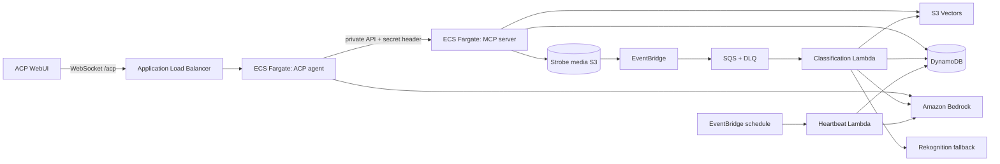

# Strobe Assistant — CAB432 Assessment 2, Track A

Strobe Assistant adds AI-powered photo discovery to the serverless Strobe backend from Assessment 1. A user can search their own photo library conversationally, see grounded image results inline, and inspect automatic classifications created asynchronously after upload. A scheduled heartbeat records autonomous retrospective runs.

## What is implemented

- Amazon Bedrock integration for chat, image understanding, and Titan text embeddings.
- Amazon S3 Vectors cosine-similarity search, filtered by Strobe user ID.
- A dedicated FastMCP service with `search_photos`, `get_recent_posts`, and `get_agent_runs` tools.
- The supplied ACP web client, extended with a production agent that sends and receives inline images.
- S3 → EventBridge → SQS → Lambda asynchronous classification, with a DLQ and partial-batch failure handling.
- EventBridge → Lambda autonomous heartbeat with durable DynamoDB run history.
- Separate MCP and ACP agent containers on ECS Fargate; an internal ALB gives MCP a stable private endpoint while only the ACP ALB is internet-facing.
- Secrets Manager injection for MCP authentication; no secret values in source or task environment declarations.
- Idempotent AWS deployment, unit tests, Ruff, TypeScript checks, and Docker health checks.

The target region is `ap-southeast-2`, the student prefix is `n11553758`, and every managed resource is tagged `qut-username=n11553758@qut.edu.au` and `purpose=assessment 2`.

## Architecture



See [architecture.md](docs/architecture.md) for trust boundaries, scaling, and design decisions.

## Repository layout

```text
infra/deploy.py                 Idempotent AWS provisioner and submission manifest writer
server/strobe-agent.ts          ACP agent, retrieval orchestration, and Bedrock response
src/strobe_assistant/           Python domain/services, Lambda handlers, and MCP server
web/                            ACP browser client
tests/                          Python and TypeScript unit tests
docs/                           Architecture, operations, testing, and presentation guide
submission-agent-infra.yml      Assessment resource manifest
```

## Local setup

Requirements: Node.js 22+, Python 3.12+, Docker Desktop, and AWS CLI v2 configured for the CAB432 account.

```powershell
Copy-Item .env.example .env
npm ci
py -3.13 -m venv .venv
.\.venv\Scripts\python.exe -m pip install -e ".[dev]"
```

The checked-in `.env.example` documents every setting. `.env` is ignored and contains configuration only; AWS credentials remain in the configured AWS profile.

Run all local quality gates:

```powershell
.\.venv\Scripts\ruff.exe check .
.\.venv\Scripts\ruff.exe format --check .
.\.venv\Scripts\pytest.exe
npm test
npm run build
npm run build:server
docker build -f Dockerfile.mcp -t strobe-assistant-mcp:test .
docker build -f Dockerfile.agent -t strobe-assistant-agent:test .
```

For a UI-only smoke test, run `npm run server:deterministic` and `npm run dev`. For the real local stack, start the MCP service on port 8081 and `npm run server`; both require valid AWS credentials and deployed data.

## Deploy

```powershell
aws sts get-caller-identity
aws configure get region
.\.venv\Scripts\python.exe infra\deploy.py
```

The deployer is repeatable. It builds and pushes both images, provisions integrations, updates ECS services, and writes real identifiers to `submission-agent-infra.yml`. Use `--skip-images` only when the current `latest` images already exist in ECR.

Full instructions are in [deployment.md](docs/deployment.md). The live demonstration sequence is in [presentation-script.md](docs/presentation-script.md).

## Important Bedrock account note

The CAB432 account currently permits `amazon.titan-embed-text-v2:0`, which is used for real embeddings and S3 Vectors retrieval. During verification on 2 October 2026, the organisation SCP explicitly denied every tested generative Bedrock model, including Nova Lite. The code still uses Bedrock as its sole LLM provider and is ready when access is restored. Until then:

- classification tries Rekognition and, when that is also denied, records a clearly identified low-confidence metadata fallback before embedding it with Titan;
- ACP answers return retrieved evidence and inline images without inventing a generated narrative;
- heartbeat runs persist with `degraded` status and an explicit model-unavailable summary.

This degradation is deliberate and observable; it does not silently fabricate successful model output.

## Documentation

- [Architecture and decisions](docs/architecture.md)
- [Deployment and operations](docs/deployment.md)
- [Testing and evidence](docs/testing.md)
- [Requirements traceability](docs/requirements-traceability.md)
- [Detailed Arabic presentation script](docs/presentation-script.md)

## Git workflow

The repository uses only `main` and `develop`. Feature work is integrated into `develop`; a reviewed pull request promotes a release to `main`. Deployment is performed manually with the documented deployer.

No Git remote is configured in this checkout, so the GitHub repository itself cannot be renamed or pushed from here. The project/package name has been normalized to `strobe-assistant`; after connecting the remote, use the same lowercase kebab-case name on GitHub.
