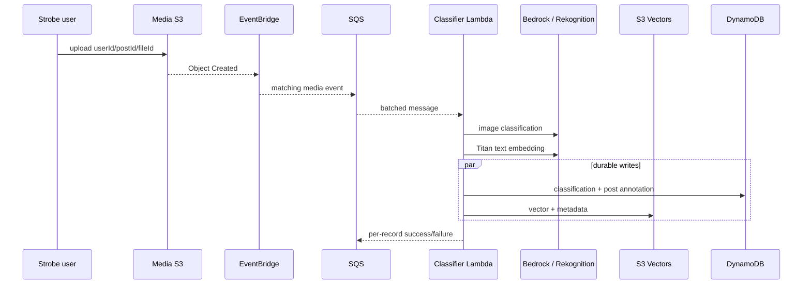

# Architecture and design decisions

## System context

Strobe Assistant extends the six-entity Assessment 1 backend without changing its upload contract. Media objects still use `userId/postId/fileId`, which lets the asynchronous classifier recover tenancy and post ownership without a synchronous API call.

The system deliberately separates three responsibilities:

1. The public ACP agent owns conversation state, calls the model, and formats inline images.
2. The private MCP server owns retrieval tools and access to Strobe data.
3. Lambda workers own background classification and scheduled activity.

This boundary makes the MCP server demonstrably independent from both the UI and model-calling code.

## Component view

| Component | Runtime | Responsibility | Scaling unit |
|---|---|---|---|
| ACP agent + web assets | ECS Fargate/Node.js | ACP WebSocket, orchestration, grounded response | ECS task/ALB target |
| MCP server | ECS Fargate/Python | Authenticated tools for vectors, posts, and run memory | ECS task, internal ALB |
| Classifier | Lambda/Python | Classify, embed, persist, and index uploaded media | SQS message |
| Heartbeat | Lambda/Python | Autonomous retrospective and durable run record | Scheduled invocation |
| Vector index | S3 Vectors | 1,024-dimensional cosine nearest-neighbour search | Managed service |
| Operational data | DynamoDB | Classifications, agent runs, idempotency, A1 data | Managed partitions |

## Upload and classification sequence

SQS absorbs bursts and gives Lambda controlled retries. Failed messages eventually enter the DLQ instead of blocking upload. The handler returns partial batch failures so successful records are not repeated.

## Retrieval and tenancy

Each vector contains a reference to the media object plus classification metadata. `userId` is filterable and is mandatory on every semantic query. The MCP server signs S3 result URLs for five minutes; the media bucket is never made public. The LLM receives only the retrieved context needed for the response.

## Security boundaries

- The internet can reach only the ALB and ACP agent security group.
- The MCP service has no public load balancer; an internal ALB gives it a stable VPC-only endpoint.
- The MCP API key lives in Secrets Manager. ECS injects it into MCP and the agent retrieves it at runtime through its task role.
- Constant-time API-key comparison protects the private HTTP adapter.
- AWS credentials use task/Lambda roles and the local AWS profile; they are absent from `.env`, images, and Git.
- DynamoDB and S3 Vectors requests are constrained by the user identifier at the application boundary.
- CloudWatch receives container and Lambda logs; X-Ray tracing is enabled for Lambda.

## Resilience and cost

Serverless storage, Lambda, and SQS scale to zero or by demand. ECS runs one small task per service for the live assessment and can increase desired count without state migration. SQS retries transient failures, the DLQ preserves poison messages, and all external AWS calls use SDK adaptive retry behavior. DynamoDB uses on-demand billing. S3 Vectors avoids maintaining a vector database cluster.

The Bedrock degradation path is explicit. If a generative call is denied, classification tries Rekognition; if the teaching policy denies both, it records a conservative filename-metadata fallback with a distinct model ID. Chat still returns vector-grounded matches. Embeddings remain Bedrock Titan; a failure there correctly fails and retries the job because semantic indexing is a core invariant.

## OOP and code boundaries

`Container` composes SDK clients and application services. `BedrockService`, `VectorStore`, `StrobeRepository`, `ImageClassifier`, and `HeartbeatService` encapsulate one reason to change and accept dependencies through constructors, which keeps unit tests deterministic. The TypeScript `McpGateway` and `StrobeAssistantAgent` similarly isolate transport from orchestration.
